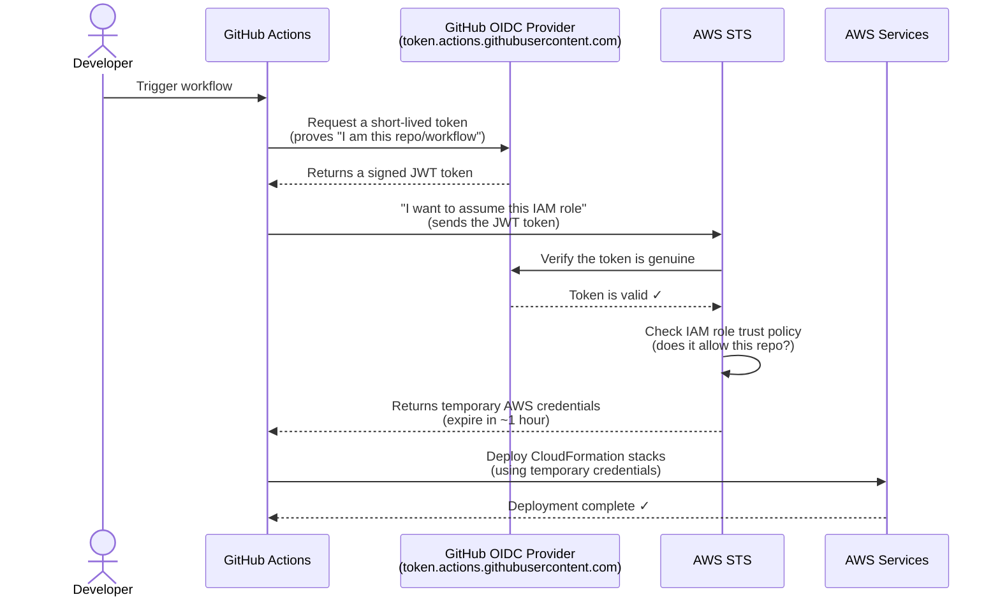

# Deployment Prerequisites

Two workflows handle deployments:

- **`deploy-infra.yml`** — manually triggered (`workflow_dispatch`); deploys layers 1–4. Binds to a GitHub Environment, so it reads environment-scoped secrets and variables.
- **`deploy-dispatch.yml`** — event-triggered (`repository_dispatch`); deploys the ECS service stack (layer 5). Does **not** bind to a GitHub Environment, so it reads from repository-level variables only.

The setup below distinguishes which workflow needs each value.

---

## 1. GitHub Environment variables (`deploy-infra.yml`)

Set these per environment under **Settings → Environments → (env) → Variables**.

| Variable | Description | Example |
|---|---|---|
| `AWS_REGION` | AWS region where all stacks are deployed | `ap-southeast-2` |

Steps:

1. Go to **Settings → Environments**, select (or create) `dev`.
2. Under **Environment variables**, add `AWS_REGION`.
3. Repeat for `prod` (can be a different region if needed).

---

## 2. GitHub Repository variables (`deploy-dispatch.yml`)

`deploy-dispatch.yml` triggers on `repository_dispatch` events and has no
`environment:` binding, so environment-scoped values are never injected. It
reads these from repository-level variables instead.

Set these under **Settings → Variables → Actions → Repository variables**.

| Variable | Description | Example |
|---|---|---|
| `AWS_REGION` | Same region as the environment variable above | `ap-southeast-2` |
| `AWS_DEPLOY_ROLE_ARN` | ARN of the IAM role to assume for the dispatch workflow | `arn:aws:iam::<account-id>:role/<role-name>` |

> **Note:** `deploy-infra.yml` reads `AWS_DEPLOY_ROLE_ARN` from an environment
> *secret* (section 3 below). `deploy-dispatch.yml` reads it from a repository
> *variable*. Both must be configured — they are separate GitHub settings.

---

## 3. GitHub Environment secrets (`deploy-infra.yml`)

Set these per environment under **Settings → Environments → (env) → Secrets**.

| Secret | Description |
|---|---|
| `AWS_DEPLOY_ROLE_ARN` | ARN of the IAM role the workflow assumes via OIDC |

---

## 4. IAM deploy role

The deploy workflows authenticate to AWS via OIDC federation — no long-lived
access keys are stored in GitHub. You create an IAM role in your AWS account
and store its ARN in both locations described in sections 2 and 3.

### How OIDC authentication works



No passwords or long-lived access keys are stored anywhere. GitHub proves its
identity with a signed token, AWS verifies it, and the temporary credentials
expire automatically after the workflow finishes.

### Add the GitHub OIDC provider (once per account)

```bash
aws iam create-open-id-connect-provider \
  --url https://token.actions.githubusercontent.com \
  --client-id-list sts.amazonaws.com \
  --thumbprint-list 6938fd4d98bab03faadb97b34396831e3780aea1
```

### Trust policy

Repositories created after **July 15, 2026** (or opted in to immutable subject
claims) include numeric owner and repository IDs in the OIDC `sub` claim.

The `sub` format differs depending on whether you use a **personal account** or
a **GitHub organisation**:

| Account type | `sub` format |
|---|---|
| Personal | `repo:<username>@<userId>/<repo>@<repoId>:*` |
| Organisation | `repo:<org>@<orgId>/<repo>@<repoId>:*` |

#### Step 1 — Find your numeric IDs

**Personal account:**

```bash
# user ID
curl -s https://api.github.com/users/<username> | jq .id

# repo ID
curl -s https://api.github.com/repos/<username>/<repo> | jq .id
```

**Organisation:**

```bash
# org ID
curl -s https://api.github.com/orgs/<org> | jq .id

# repo ID
curl -s https://api.github.com/repos/<org>/<repo> | jq .id
```

#### Step 2 — Create the trust policy

Replace `<account-id>` with your AWS account ID and the `sub` value with the
format that matches your account type.

```json
{
  "Version": "2012-10-17",
  "Statement": [
    {
      "Effect": "Allow",
      "Principal": {
        "Federated": "arn:aws:iam::<account-id>:oidc-provider/token.actions.githubusercontent.com"
      },
      "Action": "sts:AssumeRoleWithWebIdentity",
      "Condition": {
        "StringEquals": {
          "token.actions.githubusercontent.com:aud": "sts.amazonaws.com"
        },
        "StringLike": {
          "token.actions.githubusercontent.com:sub": "repo:<owner>@<ownerId>/<repo>@<repoId>:*"
        }
      }
    }
  ]
}
```

The `sub` condition uses `*` to cover both workflows — `deploy-infra.yml`
(which sends `environment:<env>`) and `deploy-dispatch.yml` (which sends no
environment). To lock down each to its own role, create two roles with more
specific `sub` conditions:

| Workflow | `sub` condition value |
|---|---|
| `deploy-infra.yml` | `repo:<owner>@<ownerId>/<repo>@<repoId>:environment:dev` |
| `deploy-dispatch.yml` | `repo:<owner>@<ownerId>/<repo>@<repoId>:ref:refs/heads/main` |

### Permissions policy

Attach this policy to the role. It covers all five infrastructure layers plus
the SSM fetch for the ALB certificate.

```json
{
  "Version": "2012-10-17",
  "Statement": [
    {
      "Sid": "CloudFormationDeploy",
      "Effect": "Allow",
      "Action": [
        "cloudformation:CreateStack",
        "cloudformation:UpdateStack",
        "cloudformation:DescribeStacks",
        "cloudformation:DescribeStackEvents",
        "cloudformation:DescribeChangeSet",
        "cloudformation:CreateChangeSet",
        "cloudformation:ExecuteChangeSet",
        "cloudformation:DeleteChangeSet",
        "cloudformation:GetTemplateSummary",
        "cloudformation:ValidateTemplate"
      ],
      "Resource": "*"
    },
    {
      "Sid": "SSMGetAlbParameters",
      "Effect": "Allow",
      "Action": "ssm:GetParameter",
      "Resource": "arn:aws:ssm:<region>:<account-id>:parameter/*/alb/*"
    },
    {
      "Sid": "IAMManage",
      "Effect": "Allow",
      "Action": [
        "iam:CreateRole",
        "iam:AttachRolePolicy",
        "iam:DetachRolePolicy",
        "iam:DeleteRole",
        "iam:GetRole",
        "iam:PassRole",
        "iam:TagRole",
        "iam:PutRolePolicy",
        "iam:DeleteRolePolicy",
        "iam:GetRolePolicy"
      ],
      "Resource": "*"
    },
    {
      "Sid": "ECSAndRelatedServices",
      "Effect": "Allow",
      "Action": [
        "ecs:*",
        "ec2:*",
        "elasticloadbalancing:*",
        "logs:*",
        "servicediscovery:*",
        "application-autoscaling:*"
      ],
      "Resource": "*"
    },
    {
      "Sid": "S3TemplatesBucket",
      "Effect": "Allow",
      "Action": [
        "s3:GetObject",
        "s3:PutObject"
      ],
      "Resource": "arn:aws:s3:::cf-templates-*/*"
    }
  ]
}
```

> **Note:** The `ECSAndRelatedServices` statement uses broad actions for
> simplicity. For production, scope each action to only the resources your
> stacks create (by ARN prefix or tag condition).

### Store the role ARN in GitHub

1. Go to **Settings → Environments**, select the `dev` environment.
2. Under **Environment secrets**, add `AWS_DEPLOY_ROLE_ARN`:
   ```
   arn:aws:iam::<account-id>:role/<role-name>
   ```
3. Repeat for `prod` (recommended to use a separate role per environment).
4. Also add `AWS_DEPLOY_ROLE_ARN` as a repository variable (section 2) for `deploy-dispatch.yml`.

---

## 5. ACM certificate

The ALB stack (`02-alb`) requires an HTTPS certificate. The certificate ARN is
stored in SSM (section 6) so it is never committed to the repository. The
certificate must be in the **same region** as the ALB.

### Option A: Request a new public certificate (recommended)

1. Open the [ACM console](https://console.aws.amazon.com/acm/) in your target region.
2. Click **Request a certificate** → **Request a public certificate**.
3. Enter your domain name, e.g. `api.example.com` or `*.example.com` for a wildcard.
4. Choose a validation method:
   - **DNS validation** (recommended) — add the CNAME record ACM shows to your DNS zone.
   - **Email validation** — an email is sent to the domain's registered contacts.
5. Complete validation. The certificate status changes to **Issued**.
6. Copy the ARN from the certificate detail page:
   ```
   arn:aws:acm:<region>:<account-id>:certificate/<uuid>
   ```

### Option B: Import an existing certificate

If you already have a certificate from an external CA:

1. In the ACM console, click **Import a certificate**.
2. Paste your certificate body, private key, and certificate chain.
3. Click **Import** and copy the ARN from the detail page.

### Using the CLI

```bash
# Request a certificate
aws acm request-certificate \
  --domain-name api.example.com \
  --validation-method DNS \
  --region <region>

# List existing certificates to find the ARN
aws acm list-certificates --region <region>
```

---

## 6. SSM parameters

The `Deploy 02-alb` step fetches the certificate ARN from SSM at deploy time
so it is never stored in the repository. Create the parameter after obtaining
the ARN from section 5.

| Environment | SSM Parameter Path |
|---|---|
| dev | `/dev/alb/certificate-arn` |
| prod | `/prod/alb/certificate-arn` |

```bash
aws ssm put-parameter \
  --name "/dev/alb/certificate-arn" \
  --value "arn:aws:acm:<region>:<account-id>:certificate/<uuid>" \
  --type String \
  --region <region>
```

---

## 7. ECR repository

The ECS service stack (`04-ecs-service`) pulls a container image from ECR. The
repository must exist before the service stack is deployed.

```bash
aws ecr create-repository \
  --repository-name web-app \
  --region <region>
```

The image must be pushed and tagged before the service starts:

| Environment | Expected image tag |
|---|---|
| dev | `dev-latest` |
| prod | `prod-latest` |

The `deploy-dispatch.yml` workflow receives the image URI from the upstream
build repository's dispatch payload, so the parameter file value is overridden
at deploy time. However, **both `parameters/dev/04-ecs-service.json` and
`parameters/prod/04-ecs-service.json` contain a placeholder account ID
(`111122223333`) in `ContainerImageUri`** — update these to your real account
ID before any manual deployment that reads from the file directly:

```json
"ContainerImageUri": "<account-id>.dkr.ecr.<region>.amazonaws.com/web-app:dev-latest"
```

---

## 8. Application Auto Scaling service-linked role

The ECS service stack creates an auto scaling target that references the
`AWSServiceRoleForApplicationAutoScaling_ECSService` service-linked role. AWS
creates this role automatically the first time you use ECS Application Auto
Scaling in an account (e.g. via the console). If the account has never done
this, create it manually before deploying `04-ecs-service`:

```bash
aws iam create-service-linked-role \
  --aws-service-name ecs.application-autoscaling.amazonaws.com
```

Check whether it already exists:

```bash
aws iam get-role \
  --role-name AWSServiceRoleForApplicationAutoScaling_ECSService
```

---

## 9. ALB access logs bucket (optional)

Both `parameters/dev/02-alb.json` and `parameters/prod/02-alb.json` leave
`AccessLogsBucketName` empty, which disables ALB access logging. This is
intentional for dev. For prod, it is strongly recommended to enable it.

The bucket must be in the **same region** as the ALB, and requires a bucket
policy that grants the ALB service permission to write logs.

### Step 1 — Create the bucket

```bash
aws s3api create-bucket \
  --bucket my-alb-access-logs-prod \
  --region <region> \
  --create-bucket-configuration LocationConstraint=<region>
```

> Skip `--create-bucket-configuration` if your region is `us-east-1`.

### Step 2 — Block public access

```bash
aws s3api put-public-access-block \
  --bucket my-alb-access-logs-prod \
  --public-access-block-configuration \
    "BlockPublicAcls=true,IgnorePublicAcls=true,BlockPublicPolicy=true,RestrictPublicBuckets=true"
```

### Step 3 — Attach the ALB logging bucket policy

The ALB service account ID is region-specific; find yours in the
[AWS docs](https://docs.aws.amazon.com/elasticloadbalancing/latest/application/enable-access-logging.html#attach-bucket-policy).
Replace `<elb-account-id>`, `<account-id>`, and `<bucket-name>` with your values.

```json
{
  "Version": "2012-10-17",
  "Statement": [
    {
      "Effect": "Allow",
      "Principal": {
        "AWS": "arn:aws:iam::<elb-account-id>:root"
      },
      "Action": "s3:PutObject",
      "Resource": "arn:aws:s3:::<bucket-name>/AWSLogs/<account-id>/*"
    }
  ]
}
```

Save this as `alb-logs-policy.json`, then apply it:

```bash
aws s3api put-bucket-policy \
  --bucket my-alb-access-logs-prod \
  --policy file://alb-logs-policy.json
```

### Step 4 — Update the parameter file

```json
"AccessLogsBucketName": "my-alb-access-logs-prod"
```

---

## 10. CloudWatch log group encryption (optional)

The ECS service stack accepts an optional KMS CMK ARN via `LogGroupKmsKeyId`
in `parameters/<env>/04-ecs-service.json`. Leaving it empty (the default) uses
AWS-managed encryption for the CloudWatch log group, which is acceptable for
most use cases.

To enable CMK encryption:

1. Create a KMS key and grant CloudWatch Logs permission to use it:
   ```json
   {
     "Effect": "Allow",
     "Principal": { "Service": "logs.<region>.amazonaws.com" },
     "Action": ["kms:GenerateDataKey*", "kms:Decrypt"],
     "Resource": "*"
   }
   ```
2. Set the key ARN in the parameter file:
   ```json
   "LogGroupKmsKeyId": "arn:aws:kms:<region>:<account-id>:key/<uuid>"
   ```

---

## References

- [Configuring OpenID Connect in Amazon Web Services](https://docs.github.com/en/actions/security-for-github-actions/security-hardening-your-deployments/configuring-openid-connect-in-amazon-web-services)
- [GitHub — Immutable subject claims (numeric IDs)](https://docs.github.com/en/actions/reference/security/oidc#immutable-subject-claims)
- [AWS — Creating OIDC identity providers](https://docs.aws.amazon.com/IAM/latest/UserGuide/id_roles_providers_create_oidc.html)
- [ACM — Request a public certificate](https://docs.aws.amazon.com/acm/latest/userguide/gs-acm-request-public.html)
- [ACM — Import a certificate](https://docs.aws.amazon.com/acm/latest/userguide/import-certificate.html)
- [SSM Parameter Store pricing](https://aws.amazon.com/systems-manager/pricing/)
- [AWS — Service-linked roles for Application Auto Scaling](https://docs.aws.amazon.com/autoscaling/application/userguide/application-auto-scaling-service-linked-roles.html)
- [ALB — Enable access logging](https://docs.aws.amazon.com/elasticloadbalancing/latest/application/enable-access-logging.html)
- [ALB service account IDs by region](https://docs.aws.amazon.com/elasticloadbalancing/latest/application/enable-access-logging.html#attach-bucket-policy)
